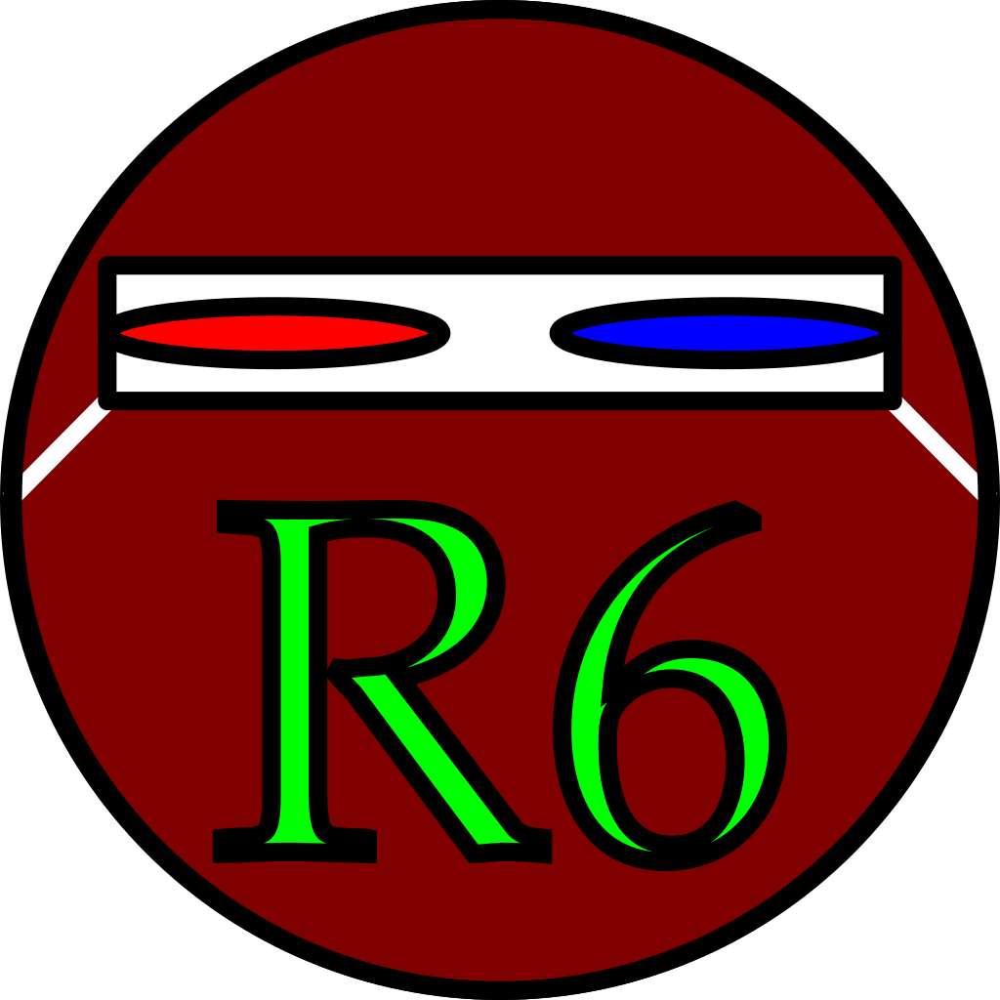
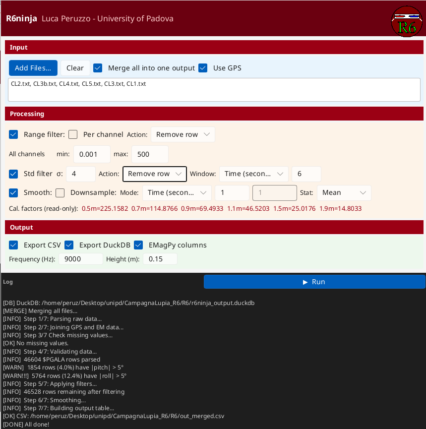

<p align="center">  </p>

## 🚀 Running R6 Ninja

Downloads available from the Releases page.

### Linux
If needed, make it executable after building or downloading:

```bash
chmod 755 r6ninja
```

### Windows
`r6ninja.exe` should be already executable, whether built or downloaded.

<p align="center">  </p>
